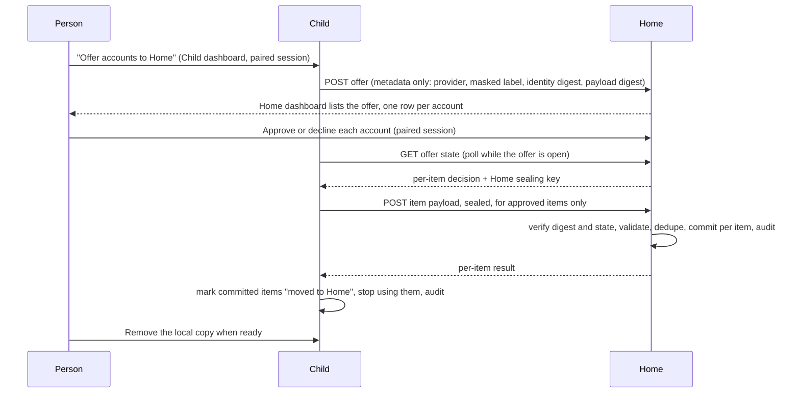
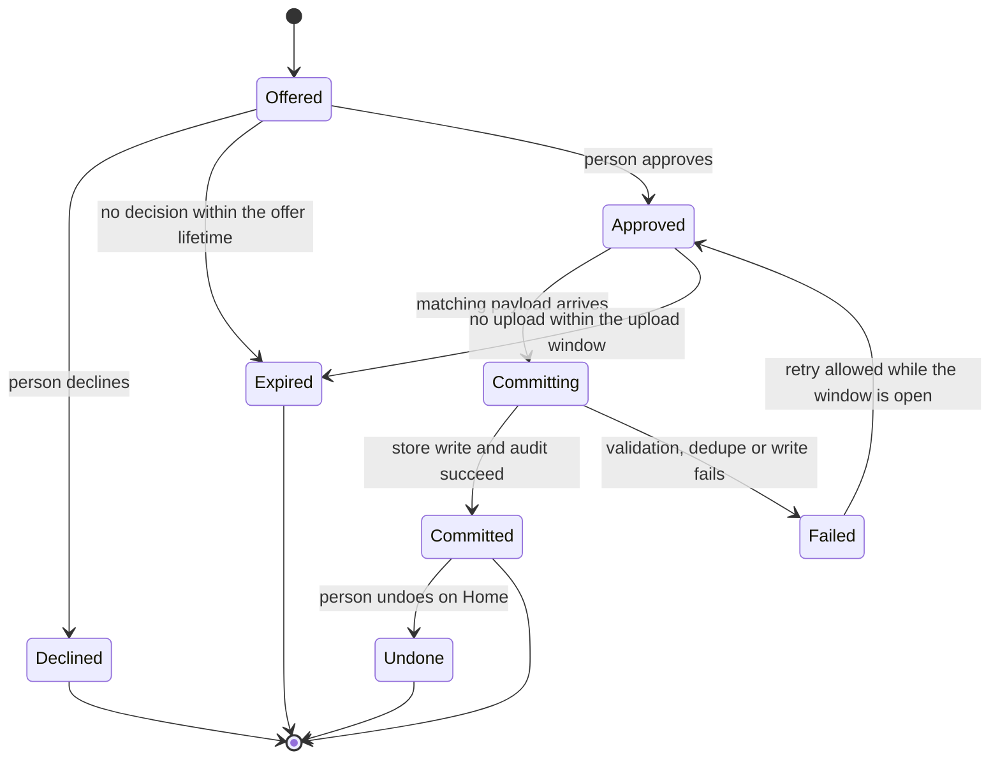

# OCX-4: moving provider accounts from a Remote Link Child to its Home

Status: design only, open for owner decisions (section 11). No product code lands with this note.

Requested by the GOAT hub design (goat-si/goat, `devlog/_plan/261021_goatclaw_hub/000_design.md` §1.8 and
brief OCX-4): "Optional, per-account consent on the Home dashboard, over the link and never through another
program. The Child keeps its copy until the person removes it." GOAT's hub switch (H7) depends on it.

## 1. What exists today

- A linked Child sends every model request to its Home. Its own providers and accounts stay on disk, labelled
  local and inactive ([Remote Link](../../../structure/remote-link.md#child-management-relay-and-home-codex-settings)).
  Account commands on a Child read the Home and refuse writes, so a Child has no way to manage its local
  accounts through the normal account surface while linked.
- The link is one-directional at the HTTP layer. Whichever side opened SSH, the Child is the HTTP client and the
  Home's hub-link listener is the server. Requests are admitted from two tables: the data plane
  (`src/link/routes.ts`) and the read-only management table (`src/link/management-routes.ts`). There is no
  Child-to-Home write path.
- Every relayed request runs on one socket proven by the relay-auth challenge (`src/link/relay-auth.ts`,
  `src/client/link-relay-transport.ts`) with a one-use session nonce
  (`src/server/index/link-relay-sessions.ts`). SSH owns host authentication and encryption.
- ADR-6032 keeps provider credentials off the link: the relay strips Bearer, `x-api-key`, `api-key`,
  `x-goog-api-key` and similar headers before attaching the link key. This feature deliberately carries
  credentials across the link, so it needs its own decision record (section 10).
- Account stores on a machine:
  - `<configDir>/auth.json`: multiauth OAuth, `provider -> { activeAccountId, accounts[] }`.
  - `<configDir>/codex-accounts.json`: the hardened Codex pool store (main plus added accounts).
  - Provider API keys and key pools in `config.json`, optionally moved to the OS keychain
    (`src/providers/key-store.ts`).
  - Accounts this machine does not own: Orca-linked Codex accounts (a source reference, refresh owned by Orca,
    see [Orca import](../../../structure/codex-home.md#orca-source-owned-account-import)), the Claude CLI sign-in,
    the native Codex sign-in under `$CODEX_HOME`, and cloud credential files such as GCP ADC.
- Quota and cooldown state:
  - API key cooldowns are process-local (`src/providers/api-key-cooldowns.ts`).
  - Per-account provider quota survives restarts in `provider-account-quota-cache.json` with a six-hour
    discard age (`src/providers/account-quota-disk.ts`); the Codex pool keeps `StoredAccountQuota` per account.
  - Auto-pause and manual pause are durable metadata on the account; refusal counters are process-local
    ([Account Auto-Pause](../../../structure/account-auto-pause.md)).
- The closest precedent for bringing accounts into a store is the Orca import: offline preview, identity
  deduplication against main, configured and orphan credentials, and retry that completes only its own
  untouched pending record.

## 2. Goal and non-goals

The person can take an account that is signed in on a Child and make it part of the Home's pool, one account
at a time, approving each on the Home dashboard. The credential travels only inside the existing link. The
Child keeps its copy, marked as moved, until the person removes it there.

Out of scope for OCX-4:

- Moving accounts from Home to Child.
- Moving provider definitions, base URLs, headers, routing profiles or combos. Only credentials move, and only
  into providers the Home already has (section 4).
- Any SSH exec, `scp`, remote `ocx` invocation carrying a secret, export file or clipboard path.
- Automatic moves. Nothing moves without a decision on the Home for that specific account.

## 3. Flow

The Child initiates because it is the only side that can send requests over the link. The Home decides.

States of one offered item on the Home:

### 3.1 Offer (Child to Home, no secrets)

`POST /v1/link-accounts/offers` on the Home's hub-link listener, admitted by a new third table next to the data
plane and management tables. The body carries an `offerId` the Child generates and up to a small fixed number
of items, each with:

- `itemId`, `provider` (the Home provider name it targets), `kind` (`codex-pool`, `oauth`, `api-key`);
- the masked identity the dashboards already show (for example a masked email or the last four key characters);
- `identityDigest`: SHA-256 over the provider name plus the stable upstream identity (account id, subject,
  or the key itself), which lets the Home detect duplicates without seeing the secret;
- `payloadDigest`: SHA-256 over the canonical credential payload the Child will send;
- optional quota hints (section 6).

The Home stores the offer in memory and in `<configDir>/link/account-offers.json` (0600, metadata only) so a
restart does not lose a pending decision. It rejects offers from links without the feature, offers for
providers the Home does not have, and more than a bounded number of open offers per link.

### 3.2 Consent (Home dashboard)

Remote Link on the Home shows "Accounts offered by <Child name>" with one row per item: provider, masked
identity, whether the Home already has the same identity, and the quota hint if one was sent. Each row has
Approve and Decline. There is no "approve all" in v1 (decision D3).

Approving requires the operator-paired dashboard session, the same rule as `POST /api/link/join`. A
credentiallessly bootstrapped loopback session and a Tailscale identity session cannot approve, because any
local process can mint the former. The Home CLI may list offers but cannot approve them (decision D4).

Approval binds to the exact `payloadDigest` and `identityDigest` that were shown. It opens a short upload
window for that item (proposal: ten minutes).

### 3.3 Upload (Child to Home, sealed)

The Child polls `GET /v1/link-accounts/offers/{offerId}` while its offer is open. For each approved item the
Home returns the decision and a per-offer X25519 public key it generated when the offer arrived. The Child
encrypts each approved payload to that key (X25519 + HKDF + AES-256-GCM, additional data =
`linkId | offerId | itemId | payloadDigest`) and sends it with
`POST /v1/link-accounts/offers/{offerId}/items/{itemId}`. The private key never leaves Home memory and is
dropped when the offer closes. Sealing is defense in depth on top of SSH and relay auth (decision D2).

The Child sends nothing for declined or undecided items. A payload is never written to disk on either side
before it reaches the destination store's existing writer.

### 3.4 Commit (Home)

For one item, under `withConfigMutationLockSync`:

1. Check the item is `Approved`, inside its window, on the same link id and current link key, and the
   decrypted payload hashes to the approved `payloadDigest`.
2. Parse the payload strictly with the same validators a local login or key add uses. Unknown fields fail.
3. Deduplicate by identity against every Home credential, including main, configured and orphan identities
   (the Orca import rule). A duplicate is refused as `already_on_home` and never overwrites the Home's copy
   (decision D5 covers replacing a Home copy that needs reauthentication).
4. Write through the owning store's writer (`auth.json` add-account path, the Codex pool store, or the key
   pool), tagged with provenance `{ movedFrom: linkId, offerId, itemId, at }`.
5. Append the audit record, then mark the item `Committed`.

Imported accounts arrive not active: an OAuth import never becomes the provider's `activeAccountId`, and a
Codex pool import starts validation-pending, as new imports do today. The person can make it active on the
Home like any other account (decision D6).

### 3.5 After commit (Child)

The Child records each committed item as moved: the account stays in its store, gains a `movedTo` marker
(Home name, link id, time), is excluded from selection and from proactive token refresh, and is shown in a new
"Moved to Home" list on the Child dashboard with a Remove action. Removing is local-only and is the only thing
that deletes the Child's copy. OpenCodex never removes it on its own, and neither does GOAT.

Because account commands on a linked Child target the Home, removal needs a local-scoped surface: the Child
dashboard list, and `ocx link moved-accounts list|remove <id>` on the Child.

## 4. What can move

| Account | Moves in v1 | Why |
| --- | --- | --- |
| OAuth multiauth account in `auth.json` (Anthropic instances, Kiro, Antigravity, xAI, Cursor, Kimi, ...) | Yes | Owned by OpenCodex, has an add-account path on the Home |
| Codex pool account in `codex-accounts.json` (added accounts) | Yes | Owned by OpenCodex |
| API key in a provider key pool, including a keychain-held key the Child can read | Yes (D7) | Owned by OpenCodex; the Home stores it in its own key store |
| Codex main account mirrored from `$CODEX_HOME/auth.json` | No (D8) | Owned by Codex on that machine |
| Orca-linked Codex account | No | A local source reference; Orca owns refresh |
| Claude CLI sign-in, GCP ADC and other external credential files | No | Owned by another program |
| Provider config: base URL, headers, models, routing | Never | A credential can be redirected by its endpoint; see the security note |

An item targets a provider that already exists on the Home with the same vendor and an endpoint the Home
already trusts. If the Home lacks the provider, the offer row says so and cannot be approved until the person
adds the provider on the Home.

## 5. Refresh-token lineage

Keeping a copy on the Child means two machines hold the same refresh token. Several upstreams rotate refresh
tokens; ChatGPT, for example, reports `refresh_token_reused` (`src/codex/chatgpt-refresh-failure.ts`). Whichever
machine refreshes first invalidates the other's copy. The design handles this by making the Child's copy
dormant at commit: excluded from selection and from proactive refresh (section 3.5). While the Child stays
linked, its local accounts are already inactive, so the marker matters most if the Child later disconnects
and runs standalone. Resuming a moved copy on a standalone Child needs an explicit action that warns it may
sign the Home out of that account (decision D1).

Implementation must confirm that no proactive refresh runs for a linked Child's inactive accounts today; this
note does not prove it.

## 6. Quotas, cooldowns and pauses

Upstream quota belongs to the account, not the machine, so an exhausted window on the Child is still exhausted
on the Home. Local counters are not facts about the account.

| State on the Child | On the Home after the move |
| --- | --- |
| API key cooldowns (process-local) | Not carried. The Home starts clean; the first 429 re-establishes a cooldown. |
| Auto-pause refusal counters (process-local) | Not carried. |
| Durable pause (manual or auto-paused) | Carried: the account arrives paused with the same reason and needs explicit resume on the Home. |
| Persisted quota windows (Codex `StoredAccountQuota`, provider account quota cache) | Carried only as a hint: unscoped windows whose reset is in the future, stamped `source: "transferred"`, discarded at reset or after the existing six-hour age, whichever comes first. They order selection and never mark the account exhausted on their own (D9). |
| Quota history samples | Not carried. The Home's history for the account starts at the move. |
| Anthropic reset grants and other ledgers | Not carried. |

The quota pool read (`/api/quota-pool`) shows a transferred hint with source `estimated` until the Home
measures the account itself. This needs a GOAT contract check before `ocx.quota-pool/1` emits it.

## 7. Audit trail

Both sides append to `<configDir>/link/account-moves.jsonl` (0600, append-only, bounded by rotation). Each line:
time, link id, offer id, item id, provider, kind, masked identity, `identityDigest`, event, actor (session kind,
never a token), and a closed result code. Events: `offered`, `approved`, `declined`, `expired`, `uploaded`,
`committed`, `failed:<code>`, `undone`, `child_marked_moved`, `child_removed`, `child_resumed`.

No line carries a token, key, refresh token, full email or `payloadDigest`. `bun run privacy:scan` gains a
fixture for the format.

The Home exposes the audit through `GET /api/link/account-moves` on its dashboard. The Child exposes its own.

## 8. Failure and rollback

Each item commits on its own. A batch is a convenience for the person, not a transaction.

| Failure | Result |
| --- | --- |
| Link drops before the offer reaches the Home | Child keeps the offer local and resends with the same `offerId`; the Home deduplicates by offer id. |
| Link drops after approval, before upload | Item stays `Approved` until its window ends; the Child uploads when the link returns. |
| Link drops during upload | The Child does not know the outcome. It re-polls; the Home's item state says `Committed` or still `Approved`. A second upload of a committed item answers `already_committed` and changes nothing. |
| Home crashes during commit | The store writers are atomic, and commit order is store write, audit, state. On restart, an `Approved` item whose identity already exists with this item's provenance is promoted to `Committed`; anything else stays `Approved` and can be retried. |
| Validation, dedupe or provider-missing failure | Item goes to `Failed` with a closed code; the Child's copy is unchanged and not marked moved. |
| Link revoked or key rotated mid-offer | Every open offer on that link expires; uploads are refused. Committed items stay. |
| Child never learns about a commit | The Child's copy stays active-capable rather than dormant; the next poll or the Home audit view corrects it. This is the safe direction because nothing is lost. |

Rollback after commit is **Undo** on the Home row, available while the account still carries this move's
provenance. It removes the Home copy through the normal account deletion path and audits `undone`. Because the
Child kept its copy, undo loses nothing. The Child sees `undone` on its next poll and clears the `movedTo`
marker, so its copy becomes usable again (subject to section 5: if the Home already refreshed a rotating token,
the Child's copy may need a new sign-in, and the row says so).

## 9. GOAT hub switch (H7)

H7 moves the hub from the current Home (A) to a new Home (B), keeping A as the rollback until B is proven.
OCX-4 supplies its `PoolMoving` step. Two account sources exist:

1. Accounts on Children. When a Child relinks to B in `Relinking`, it can offer its local accounts to B with
   this flow, exactly as any Child would.
2. Accounts on A itself, which is the main pool. A is a Home, so it has no client link to B. H7 needs A to
   offer to B over a link where A is the HTTP client. This design proposes an account-source link: a
   Child-initiated link from A to B that enrolls through the normal probe, host confirmation and apply path,
   uses relay auth, admits only the `/v1/link-accounts` table, and does not switch A's own client traffic or
   connection state. A keeps serving its Children throughout (decision D10).

H7 drives the steps through OpenCodex surfaces and never handles a credential:

- On A (or a Child): `ocx link offer-accounts --link-id <id> [--provider ...]` creates the offer. GOAT may run
  it through its existing runner; the command prints offer and item ids only.
- On B: the person approves each account on B's dashboard. GOAT shows a decision item that links there; it does
  not approve on the person's behalf, and the approval route refuses every non-paired session.
- GOAT reads progress from `GET /api/link/account-offers` and `GET /api/link/account-moves` (metadata only)
  to decide when `PoolMoving` is done.
- `RolledBack`: GOAT asks the person to Undo on B, or leaves B's copies in place; A still holds every account,
  dormant only if A marked them moved. On rollback A's markers are cleared through the same undo signal.
- `Committed`: A's copies stay on A, marked moved. The person removes them from A's dashboard when satisfied,
  as §1.8 of the GOAT design already says.

The `/readyz` feature `link-account-move/1` ([Runtime](../../../structure/runtime.md), `src/remote/features.ts`)
lets GOAT and the Child check support on both ends before offering.

## 10. Implementation outline (for the follow-up PRs)

1. Decision record under Remote Link that extends ADR-6032: credentials may cross the link only as a sealed
   account-move payload on the account-move table, never as forwarded request headers.
2. `src/link/account-move-routes.ts` (table, admission), Home offer book and commit, Child offer client and
   `movedTo` marker, sealing helper, audit writer.
3. Home dashboard offer panel and Child "Moved to Home" list (GUI PR with screenshots).
4. CLI: `ocx link offer-accounts`, `ocx link account-offers` (Home, read-only), `ocx link moved-accounts` (Child).
5. Account-source link kind for H7 (only if D10 is accepted).
6. `structure/remote-link.md` section, `structure/quota-pool.md` for transferred hints, docs-site Remote Link
   guide.

Tests: a real two-listener link fixture with isolated homes covering offer, approval refusal for loopback and
Tailscale sessions, digest mismatch, replay of a committed upload, link revocation mid-offer, crash recovery
between store write and state, dedupe, undo, the Child dormant marker, and no secret in any audit or log line.

## 11. Decisions for the owner

| ID | Question | Proposal |
| --- | --- | --- |
| D1 | What happens to the Child's copy after commit | Keep it, dormant (no selection, no refresh) until the person removes or explicitly resumes it |
| D2 | Seal payloads on top of SSH and relay auth | Yes, per-offer X25519 key held in Home memory |
| D3 | Allow "approve all" for an offer | No in v1; one decision per account |
| D4 | Can the Home CLI approve | No; dashboard paired session only. CLI lists offers |
| D5 | Same identity already on the Home | Refuse as `already_on_home`; later option to replace only when the Home copy needs reauthentication |
| D6 | Imported account becomes active | Never automatically; validation-pending or inactive |
| D7 | Include API keys (and keychain-held keys) in v1 | Yes for key pools; keychain keys only when the Child can read them without prompting |
| D8 | Include the Codex main account | No; it belongs to Codex on that machine. Revisit only with a Codex-owned export |
| D9 | Carry quota windows | Only as hints with future resets, never as exhaustion; durable pauses carried as pauses |
| D10 | H7 source for the old Home's own pool | Account-source link (offer-only, no traffic switch). Alternatives: make A a full Child of B (breaks A serving its Children) or re-sign every account on B (no move at all) |
| D11 | Offer and upload windows | Offer lifetime 24 h, upload window 10 min after approval |
| D12 | Who may start an offer on the Child | Child paired dashboard session or Child CLI with its admin token |

The security analysis is in [010_security.md](010_security.md).

