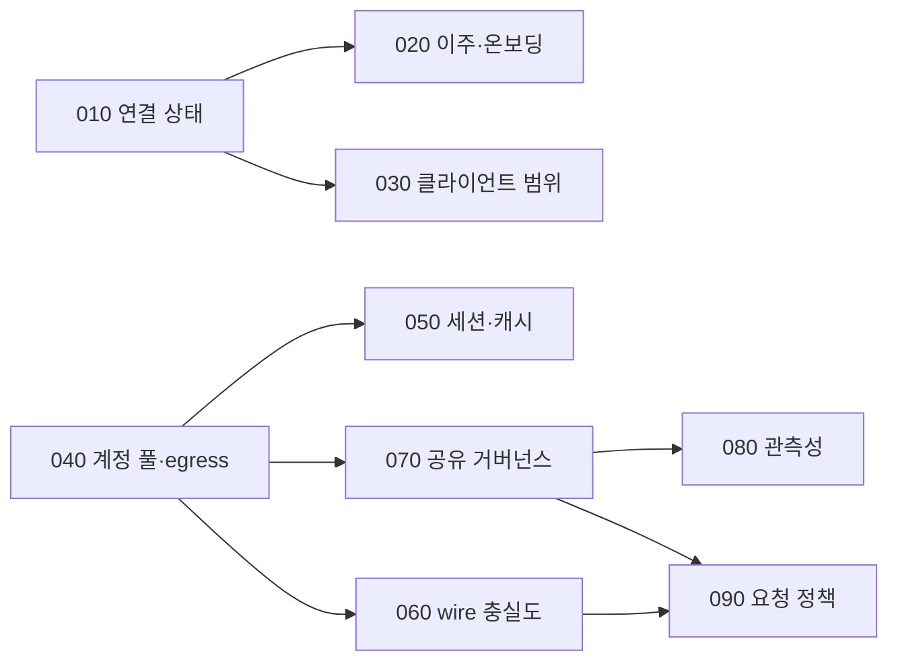

# 009 — Gap matrix, 우선순위, 단계 배치, 비채택 목록

Unit `261123_proxy_upstream_catchup` · coordinator 종합 · 입력: 001–008 (레인 L1–L8, `gpt-6.2-sol` xhigh)

## 판정 규칙

- 행 하나는 사용자 관점 능력 하나다. 레인 후보(`L<n>-<k>`)는 `CAP-<topic>` 태그로 묶었고, 같은 능력을 여러 프로젝트가 보여 주면 출처에 모두 적었다 (예: G-012는 CPA L2-1과 sub2api L4-04).
- 근거 열은 레인 문서의 후보 id다. 실제 `path:line` 인용은 해당 레인 문서의 인벤토리와 absence receipt에 있다. 인용 2,402개는 `.tmp/chase/` 고정 사본에 대해 전부 해석됐다 (`verify_citations.mjs`, unresolved 0).
- 008(L8)이 OpenCodex 쪽 증거의 기준이다. L8은 `rg` 패턴 5종(embeddings/rerank, deep link, WebDAV/S3, tenant/billing 테이블, Gemini Live)에 대해 고정 트리 `src gui/src desktop/src-tauri/src` 범위의 absence receipt를 남겼다 (008 Gap candidates). 각 행의 "없음" 주장은 해당 레인 문서의 receipt를 따른다.
- 가치는 대상 사용자 기준이다: Codex/Claude Code를 로컬 proxy로 쓰는 개인, 그리고 proxy 하나를 공유하는 소규모 팀. 노력은 레인 추정(S/M/L/XL)을 따르되 병합 행은 큰 쪽을 택했다.
- 단계 열: `0X0` = 채택하여 해당 단계 문서에 배치, `DEFER` = 수요·선행 조건 확인 뒤 재평가, `REJECT` = 제품 범위 밖, `CLOSED` = 고정 head의 OpenCodex에 이미 있어 gap이 아님 (감사에서 확인).

## 우선순위 규칙

1. **클라이언트 마찰을 먼저 다룬다 (로드맵 판단).** magpie(별 40k, 2026-11-23)와 cc-switch는 설정 전환·이주를 전면에 둔다. 레인 003·007의 날짜가 붙은 보고와 Aside 10월 기록(Linux.do에서 503과 설정 마찰을 이유로 든 사례)은 설정·이주 마찰이 있다는 정성적 신호다. 이것이 이탈의 최상위 원인이라는 순위나 빈도를 보여 주지는 않는다. 010을 먼저 두는 것은 그 신호에 근거한 판단이다.
2. **런타임 신뢰성은 공유 인프라부터.** 계정 선택 snapshot·lease(040)가 cache affinity(050), 호출자 상한(070)의 선행 조건이다.
3. **OpenCodex가 앞선 계약은 건드리지 않는다.** fail-closed `refused-ambiguous` 재전송 게이트, Responses WS steer/inject, Kiro wire, Vertex 서비스 계정, xAI OAuth/Responses replay는 유지한다 (아래 "이전 기록 정합"). magpie의 투명 rotation(전송 오류 후 후보 교체)은 채택하지 않는다; 006 요약 3번이 두 동작 차이만으로 503/중복 과금 빈도를 판단할 수 없다고 기록했다.
4. **동의가 필요한 행동은 기본 off.** 계정 자격 증명 이동(G-004), 실제 CLI 세션 유지(G-021), masking(G-035), 알림 외부 전송(G-030)은 명시적 opt-in과 AGENTS_INSTALL.md의 consent 규칙을 따른다.

## Gap matrix

| ID | CAP | 갭 | 출처 | 근거 (lane 후보) | 가치 | 노력 | 단계 |
|---|---|---|---|---|---|---|---|
| G-001 | CAP-client-config-codex · CAP-client-config-claude · CAP-client-config-drift | Codex·Claude Code 앱별 현재 목적지(proxy/native/remote), 소유권, drift 사유, 복원 미리보기를 한 화면에서 보기 | CCS · MGP | 003 L3-1 · 007 L7-5 | high | M | 010 |
| G-002 | CAP-client-config-claude | 기존 first-party 토글(`gui/src/pages/ClaudeCode.tsx:293`, rollback `agent-settings-routes.ts:1760`)에 빠진 것: 적용 전 `settings.json` 변경 preview와 `CLAUDE_CONFIG_DIR`(home)별 상태 표시 | MGP · CCS | 007 L7-1 · 003 인벤토리 · audit r1 #1 | high | M | 010 |
| G-003 | CAP-import-local-discovery · CAP-import-cc-switch | 설치된 앱(CC Switch, Claude/Codex 설정 등)의 공급자 설정을 자동 발견하고 검토 후 가져오기 | MGP · CCS | 007 L7-3 | high | M | 020 |
| G-004 | CAP-import-account-batch | Codex·Claude 계정 자격 증명의 명시적 일괄 가져오기와 결과 receipt (현재 account-import는 소수 형식) | MGP | 007 L7-2 | high | L | 020 |
| G-005 | CAP-deeplink-import | OS 링크(`ocx://` 류)로 relay/공급자 preset을 열어 미리보기 후 적용 | MGP · CCS | 007 L7-4 · 003 L3-2 · 008 L8-2 | high | M | 020 |
| G-006 | CAP-endpoint-speed-test | 공급자 후보 URL의 응답 시간·상태·실패를 같은 조건에서 비교하는 측정 화면 | CCS | 003 L3-3 | high | M | 020 |
| G-007 | CAP-remote-proxy-share | Hub 초대를 링크로 열어 origin을 미리 본 뒤 기존 Hub pairing으로 잇고, 원격 카탈로그 준비 상태 표시 | MGP · CCS | 007 L7-6 · 003 L3-2(Home 연결 부분) | med | M | 020 |
| G-008 | CAP-client-config-gemini | Gemini CLI를 로컬/Home proxy에 연결하고 원복하는 enable/disable | CCS | 003 L3-4 | med | M | 030 |
| G-009 | CAP-client-config-zed | Zed custom provider export와 opt-in 연결 | MGP | 007 L7-7 | med | M | 030 |
| G-010 | CAP-mcp-client-sync | Codex/Claude Code의 선택된 MCP 항목 읽기·변경 미리보기·명시적 적용 | CCS | 003 L3-8 | med | L | 030 |
| G-011 | CAP-config-import-export · CAP-backup-local | 관리 항목을 고르는 로컬 백업 번들과 복원 미리보기 (credential 기본 제외) | CCS | 003 L3-6 | med | M | 030 |
| G-012 | CAP-credential-proxy | 같은 provider pool 안에서 credential/계정별 upstream proxy·noProxy를 로그인·refresh·실행에 일관 적용 | CPA · S2A | 002 L2-1 · 004 L4-04 | high | L | 040 |
| G-013 | CAP-cooldown-persistence | API key pool의 확인된 quota cooldown을 재시작·live recycle 후 복원 | CPA | 002 L2-2 | high | M | 040 |
| G-014 | CAP-account-concurrency | Codex·Claude OAuth 계정별 동시 실행 lease와 bounded wait (Kiro에만 존재하는 lease 원리 일반화) | S2A | 004 L4-01 | high | L | 040 |
| G-015 | CAP-credential-pool-weighted · CAP-load-aware-selection | 기존 operator priority tier(`codex/routing/selection.ts:249`, `auth-api/routes.ts:204`) 안에서 정적 weight와 실시간 in-flight 부하로 고르기 (priority·pin·quota 계약 유지, G-014 이후) | S2A · CPA | 004 L4-02 · 002 L2-5 | high | L | 040 |
| G-016 | CAP-credential-files | 계정별 모델 eligibility·refresh 결과를 보여주는 진단 DTO와 명시적 검증 UI | CPA | 002 L2-3 | med | M | 040 |
| G-017 | CAP-failover | 앱별 fallback 경로 순서와 현재 후보·제외 사유 가시성 | CCS | 003 L3-9 | med | M | 040 |
| G-018 | CAP-cache-affinity | 일반 combo에서 이미 따뜻한 세션 대상을 유지하는 선택형 cache affinity | MGP | 006 L6-1 | high | M | 050 |
| G-019 | CAP-antigravity-replay | Antigravity signed context 복원 심화: 이전 문맥·part 위치 대조, native call 복원, snapshot 조건부 갱신 | CPA | 001 L1-1 | high | L | 050 |
| G-020 | CAP-xai-reasoning-replay | client가 돌려주지 않은 완료 turn의 call/reasoning을 xAI 경로에서 보강 | CPA | 001 L1-2 | med | M | 050 |
| G-021 | CAP-claude-cli-session | 실제 Claude CLI의 계정별 장기 세션 reuse/resume (현재 매 턴 stateless) | MGP | 006 L6-5 | high | XL | 050 |
| G-022 | CAP-wire-multimodal-input | 첨부만 있는 turn, file-backed 첨부, PDF, 다중 tool-result modality의 거절/보존 일관화 | CPA | 001 L1-4 | high | M | 060 |
| G-023 | CAP-wire-gemini-interactions-upstream | Gemini Interactions의 공급자 네이티브 egress (현재 local ID 경로) | CPA | 001 L1-5 | med | L | 060 |
| G-024 | CAP-wire-xai-upstream-ws | xAI upstream WebSocket과 native continuation으로 history 재전송 감소 | CPA | 001 L1-3 | med | L | 060 |
| G-025 | CAP-caller-concurrency | 공유 proxy에서 **발급 키 단위** 동시 turn 상한 (opt-in). 여러 키를 한 사람으로 묶는 집계는 G-057로 보류 | S2A | 004 L4-03 | med | L | 070 |
| G-026 | CAP-usage-per-key · CAP-key-budget | 발급 키별 request/token 예산과 거절 이유 (USD ceiling은 가격 근거 확정 후) | S2A | 005 L5-1 | high | L | 070 |
| G-027 | CAP-key-expiry | 발급 키 만료 시각·상태와 진행 중 WS/rotation 경계 | S2A | 005 L5-2 | high | M | 070 |
| G-028 | CAP-admin-audit | 키 발급/스코프/폐기와 설정 변경의 구조화된 관리 감사 이벤트 | S2A | 005 L5-4 | med | M | 070 |
| G-029 | CAP-statusline | Claude Code statusline에 현재 세션의 실제 route와 quota snapshot 표시 (opt-in) | MGP | 006 L6-2 | high | M | 080 |
| G-030 | CAP-ops-alerts | 기존 metrics의 실패·지연·429 신호에 임계치와 최근 상태를 붙인 운영 알림 (기본 off) | S2A | 005 L5-3 | med | M | 080 |
| G-031 | CAP-usage-event-export | 외부 집계기가 cursor로 읽는 관리 전용 usage event export — 이미 있음: `/api/request-history`의 `nextCursor`(`request-history-routes.ts:90`), `/api/logs` 증분 cursor(`request-log-cursor.ts:67`, process epoch 기준) | CPA | 002 L2-6 · audit r1 #2 | med | M | CLOSED |
| G-032 | CAP-usage-native-sessions | proxy를 거치지 않은 Codex/Claude 네이티브 세션 사용량을 출처 표시와 함께 집계 | CCS | 003 L3-5 | med | L | 080 |
| G-033 | CAP-management-mcp | usage/health/key metadata만 노출하는 읽기 전용 관리 MCP | S2A | 005 L5-5 | low | L | 080 |
| G-034 | CAP-payload-overrides · CAP-middleware | 운영자가 지정하는 post-translation payload default/drop과 명시 활성 **요청** body filter seam (응답 hook은 G-059) | CPA · MGP | 002 L2-4 · 006 L6-3 | med | L | 090 |
| G-035 | CAP-request-masking | 기본 off 요청 masking: 명시 필드의 deterministic 규칙, 원문 미보관, 실패 시 무전송 | MGP | 006 L6-4 | high | L | 090 |
| G-036 | CAP-gemini-explicit-cache | Gemini 명시적 cache API와 생성 계정 고정 | S2A | 004 L4-05 | low | XL | DEFER |
| G-037 | CAP-wire-embeddings-rerank | embeddings/rerank typed endpoint (magpie 등록 `mgp:internal/gateway/gateway.go:1218`; OpenCodex Gemini embed는 별도로 501) | MGP | 008 L8-1 · 006 L6-8 | med | M | DEFER |
| G-038 | CAP-wire-gemini-live | Gemini Live 양방향 세션 — peer 구현 미확인 제품 후보 (CPA Gemini 등록 `cpa:internal/api/server_routes.go:148`에 Live 없음) | — (peer 미확인) | 008 L8-5 | low | L | DEFER |
| G-039 | CAP-provider-extension-abi | 버전 고정 provider-extension ABI (OpenCode/pi 플러그인 호환) | MGP | 006 L6-6 | med | XL | DEFER |
| G-040 | CAP-sync-webdav · CAP-sync-s3 | 운영자가 실행하는 WebDAV/S3 스냅샷 백업·복원 (G-011 형식 위) | CCS | 003 L3-7 · 008 L8-3 | med | L | DEFER |
| G-041 | CAP-ip-allowlist | 발급 키별 IP 제한 | S2A | 005 L5-6 | low | M | DEFER |
| G-042 | CAP-wire-xai-speech | 범용 xAI TTS endpoint | CPA | 001 L1-6 | low | M | REJECT |
| G-043 | CAP-wire-legacy-completions | legacy `/v1/completions` facade | CPA | 001 L1-7 | low | S | REJECT |
| G-044 | CAP-wire-claude-cch | Claude CCH 재서명 | CPA | 001 L1-8 | low | M | REJECT |
| G-045 | CAP-oauth-siwc | Codex credential의 secondary SIWC bind/renew | CPA | 002 L2-7 | low | L | REJECT |
| G-046 | CAP-control-plane · CAP-credential-store-backends | Home control plane과 다중 backend credential/config mirror | CPA | 002 L2-8 | low | XL | REJECT |
| G-047 | CAP-plugin-host · CAP-plugin-distribution | native ABI plugin host, 원격 artifact 배포, marketplace 자동 업데이트 | CPA · MGP | 002 L2-9 · 006 L6-7 | low | XL | REJECT |
| G-048 | CAP-client-fingerprint | TLS fingerprint·client identity 위장 profile | S2A | 004 L4-R1 | low | L | REJECT |
| G-049 | CAP-tenant-billing | 셀프 가입/RBAC, 그룹 상품·구독, 잔액·결제·환불·리딤·promo | S2A | 005 L5-7 · 008 L8-4 | low | XL | REJECT |
| G-050 | CAP-platform-ops | 공지 포털, 운영 UI 전면 복제, 프롬프트 원문 감사, Postgres/Redis 의무화, DB setup wizard | S2A | 005 L5-8 | low | XL | REJECT |
| G-051 | CAP-wire-vendor-generic | 임의 vendor-native path 일괄 passthrough | MGP | 006 L6-8 | low | L | REJECT |
| G-052 | CAP-library-mcp · CAP-library-skills · CAP-prompt-profiles | MCP/skills Library, skills marketplace, 전역 지침 profile 전환 관리자 | MGP · CCS | 007 L7-9 · 003 L3-11 | low | XL | REJECT |
| G-053 | CAP-surface-tui | 대화형 별도 TUI | MGP | 007 L7-10 | low | L | REJECT |
| G-054 | CAP-client-config-roster | 지원 agent 수 맞추기 (60+ roster) | MGP | 007 L7-11 | low | XL | REJECT |
| G-055 | CAP-session-manager | 범용 세션 index·본문 검색·삭제·재실행 | CCS | 003 L3-10 | low | XL | REJECT |
| G-056 | CAP-client-plugin-management | 모든 클라이언트의 플러그인/마켓 설치·업데이트 관리 | CCS | 003 L3-12 | low | XL | REJECT |
| G-057 | CAP-caller-owner-aggregation | 운영자가 관리하는 owner 매핑으로 여러 발급 키를 한 사용자 slot으로 묶기 (sub2api user slot `s2a:backend/internal/handler/openai_gateway_handler.go:614`) | S2A | 004 L4-03 · audit r1 #3 | med | M | DEFER |
| G-058 | CAP-config-sync-encrypted | 양방향 클라우드 설정·sign-in 동기화 | MGP | 007 L7-8 · audit r1 #6 | low | XL | REJECT |
| G-060 | CAP-deeplink-home-link | SSH Link(Home/Child) 초대 링크 — alias·confirmed host 기반 enrollment(`ocx:src/server/management/link-routes.ts:165`)를 링크로 여는 진입점 | CCS | 003 L3-2 · audit r3 #4 | low | M | DEFER |
| G-059 | CAP-middleware-response | 응답 측 hook (SSE/WS framing 보존 계약 포함) | MGP | 006 L6-3 · audit r1 #9 | med | L | DEFER |

집계: 전체 60건 · 채택 34건 (단계 010–090) · 보류 9건 · 비채택 16건 · 이미 있음(CLOSED) 1건.

## 단계 배치와 의존 관계

| 단계 | 주제 | 갭 | 선행 단계 | 배치 이유 |
|---|---|---|---|---|
| [010](010_client_connection.md) | 클라이언트 연결 상태와 Claude 기본 실행 preview | G-001, G-002 | — | 설정·이주 마찰 신호(정성적)에 대응하는 첫 단계. 020·030이 이 화면과 journal 계약을 쓴다. |
| [020](020_migration_onboarding.md) | 이주·온보딩: 발견, 일괄 가져오기, 딥링크, 속도 측정, 팀 접속 | G-003 … G-007 | 010 | 가져온 설정은 010의 연결 화면에서 적용·확인된다. |
| [030](030_client_coverage.md) | 클라이언트 범위와 설정 이식성: Gemini CLI, Zed, MCP 동기화, 로컬 백업 | G-008 … G-011 | 010 | 010의 writer/journal/restore 계약을 재사용한다. |
| [040](040_pool_scheduling_egress.md) | 계정 풀 스케줄링과 egress: 계정별 proxy, cooldown 보존, 동시 실행 lease, 가중·부하 선택, 진단, failover 가시성 | G-012 … G-017 | — | 050·070이 쓰는 계정 선택 snapshot과 lease를 만든다. |
| [050](050_session_cache_continuity.md) | 세션 연속성과 캐시: combo cache affinity, Antigravity/xAI replay, Claude CLI 세션 reuse | G-018 … G-021 | 040 | affinity는 040의 선택 snapshot·lease 위에서만 안전하다. |
| [060](060_wire_fidelity.md) | wire 충실도: 첨부 전용 turn, Gemini Interactions egress, xAI upstream WS | G-022 … G-024 | 040 | G-024의 xAI upstream WS는 040의 계정별 egress(G-012)·강제 HTTP·pacing 정책을 따라야 한다. G-022·G-023은 040 없이 시작해도 된다. |
| [070](070_shared_proxy_governance.md) | 공유 프록시 거버넌스: 발급 키 단위 동시 상한, 키 예산, 키 만료, 관리 감사 | G-025 … G-028 | 040 | 040은 lease 구현(용량 계산)만 제공한다. 호출자 신원은 발급 키이며 키 간 집계는 G-057로 보류. |
| [080](080_observability.md) | 관측성: Claude Code statusline, 운영 알림, 네이티브 세션 사용량, 읽기 전용 관리 MCP | G-029, G-030, G-032, G-033 | 070 | statusline·MCP의 키 범위와 actor는 070의 키 수명·감사 계약이 정한다. |
| [090](090_request_policy.md) | 요청 정책: payload override/미들웨어 seam, 요청 masking | G-034, G-035 | 060, 070 | 변환 후 hook 위치는 060 이후 확정되고 키별 정책은 070의 키 모델을 쓴다. |

클라이언트 트랙(010→020/030)과 런타임 트랙(040→050/060/070)은 서로 독립이므로 두 구현 단위로 병렬 진행할 수 있다. 같은 트랙 안에서는 번호 순서를 지킨다.

## 보류(DEFER), 비채택(REJECT), 이미 있음(CLOSED) 근거

| ID | 판정 | 근거 |
|---|---|---|
| G-036 | DEFER | Gemini cache 리소스는 TTL·소유권·유료 side effect를 함께 복제해야 하고(004 L4-05), Gemini SDK 직접 사용자 수요가 확인되지 않았다. 060 이후 수요가 생기면 재평가. |
| G-037 | DEFER | Gemini embed는 등록돼 있지만 501을 반환한다(008 L8-1). 코딩 turn에서 사용 사례가 확인되지 않았다(006 L6-8). 요청이 들어오면 typed endpoint부터 산정. |
| G-038 | DEFER | peer 구현이 고정 head에서 확인되지 않은 제품 후보다(CPA Gemini 등록에 Live 없음, 008 L8-5 `unknown`). 기존 계획도 Live를 유보했다. peer trace가 생기면 재평가. |
| G-039 | DEFER | provider host는 lifecycle/RPC/auth ownership/실패 격리가 모두 필요한 XL이다(006 L6-6). 090의 seam이 자리 잡은 뒤 최소 manifest부터 검토. |
| G-040 | DEFER | 운영자가 실행하는 스냅샷 업로드·복원만 남겼다(003 L3-7, L). 030의 G-011 백업 형식이 먼저다. 양방향 sync는 G-058로 분리. |
| G-031 | CLOSED | `/api/request-history`가 영속 usage 행과 `nextCursor`를 주고 `/api/logs`는 reset 신호가 있는 증분 cursor를 준다(감사 r1 #2). 남는 것은 재시작을 넘는 forward checkpoint 보장뿐이며, 외부 집계 수요가 생기면 그 보장만 새 행으로 연다. |
| G-041 | DEFER | reverse proxy·tunnel별 주소 신뢰가 먼저 정리돼야 하고, 키 범위·만료(070)가 더 큰 효과를 낸다(005 L5-6). |
| G-057 | DEFER | 070은 발급 키 단위 상한으로 시작한다. OpenCodex admission 주체는 secret에서 파생된 키 단위다(`ocx:src/server/auth-cors.ts:483`). 여러 키를 한 사람으로 묶으려면 운영자 owner 매핑이 먼저 필요하다(감사 r1 #3). |
| G-060 | DEFER | SSH Link enrollment는 SSH alias와 확인된 host가 필요해 URL 하나로 안전하게 넘기기 어렵다. 팀 접속은 Hub pairing(G-007)으로 먼저 해결한다(감사 r3 #4). |
| G-059 | DEFER | 응답 hook은 SSE tool/reasoning/terminal frame과 WS framing 보존 계약이 따로 필요하다(006 L6-3, 감사 r1 #9). 090의 요청 seam이 자리 잡은 뒤 평가. |
| G-042 | REJECT | 음성 생성 지출이 따르고 코딩 proxy 주 경로의 이득이 낮다(001 L1-6). |
| G-043 | REJECT | 대상 클라이언트에서 연결 가치를 확인하지 못했다(001 L1-7). |
| G-044 | REJECT | native passthrough와 routed Messages의 역할이 이미 구분되며, 재서명은 client provenance·공급자 계약 문제를 만든다(001 L1-8). |
| G-045 | REJECT | 필요로 하는 사용자군을 확인하지 못했고 별도 consent·토큰 수명주기가 든다(002 L2-7). |
| G-046 | REJECT | HA control plane과 외부 credential 저장은 로컬 proxy·소규모 공유와 다른 제품이다(002 L2-8). |
| G-047 | REJECT | Bun 기본 경로에 배포·심사·rollback 부담을 더한다. 임의 코드 자동 업데이트는 provenance를 잃는다(002 L2-9, 006 L6-7). |
| G-048 | REJECT | 외부 서비스가 관찰하는 client identity를 합성하는 기능은 호환성 목표 밖이다(004 L4-R1). |
| G-049 | REJECT | 상거래·테넌트 운영은 단일 사용자 로컬 proxy 범위 밖이다. 팀 비용 통제는 G-026으로 다룬다(005 L5-7, 008 L8-4). |
| G-050 | REJECT | 인프라·마이그레이션 부담이 크고 기존 UI/metrics/Docker로 시작할 수 있다(005 L5-8). |
| G-051 | REJECT | 임의 vendor path는 모델·계정 예산과 동등한 정책 검증이 따로 필요하다(006 L6-8). |
| G-052 | REJECT | 외부 도구 실행과 skill 출처 승인이 필요한 별도 제품 영역이다. 선택적 MCP 적용은 G-010으로 좁혔다(007 L7-9, 003 L3-11). |
| G-053 | REJECT | CLI+GUI가 같은 흐름을 제공하며 두 번째 UI 유지 비용이 크다(007 L7-10). |
| G-054 | REJECT | 등록 수 경쟁은 오탐 쓰기 위험을 늘린다. 근거 있는 adapter(G-008, G-009)부터 추가한다(007 L7-11). |
| G-055 | REJECT | 원문 보관·파기 권한이 필요하다. 사용량 메타데이터는 G-032로 좁혔다(003 L3-10). |
| G-058 | REJECT | 양방향 설정·sign-in 동기화는 암호화 키·충돌·credential 병합 제품이다(007 L7-8). 스냅샷 백업(G-040)과 분리했다(감사 r1 #6). |
| G-056 | REJECT | 외부 marketplace 접근과 새 실행 권한을 도입한다(003 L3-12). |

## 이전 기록 정합 (`devlog/_chase/20_cli-proxy-api.md`, 2026-06-29 `00114be`)

| 이전 항목 | 이번 판정 | 근거 |
|---|---|---|
| Antigravity replay 깊이 (CPA 667줄 vs ocx 136줄) | 범위 축소: OpenCodex에 세션별 다중 서명·재시작 snapshot·오류 시 제거가 생겼다. 남은 차이는 문맥·part 위치 대조, native call 복원, snapshot 조건부 갱신 → G-019 | 001 요약 2번, L1-1 |
| vertex OAuth 없음 | **닫힘.** Vertex JSON 등록, OS credential store, JWT 교환, bearer 전송 구현 | 002 요약 1번 |
| xai forward-only / replay·WS 미확인 | **부분 닫힘.** Grok Responses 선택과 replay 정규화 존재. 남은 차이는 세션 보강(G-020)과 upstream WS(G-024) | 001 요약 3번, 002 요약 2번 |
| Responses WS→SSE | 양쪽 보유, OpenCodex는 steer/inject까지 | 001 요약 1번, 006 요약 2번 |
| kiro | OpenCodex 선행 유지 | 001 요약 7번 |

## 증거 한계

- 레인 문서 001–008은 모두 `최신 사례 (Aside)` 행을 갖는다 (행 수 5–13). 웹 보고는 고정 head 이후 것이면 확정 상태를 바꾸지 않았다.
- 가치·노력은 레인 추정이며 사용자 조사나 계측 데이터로 검증하지 않았다.
- 보안 관련 메모는 레인별로 없음(전원 "Scratch note: no").

## NOT RUN

- 어떤 프로젝트도 빌드·실행하지 않았다. 모든 비교는 소스 읽기와 Aside 공개 페이지 열람이다.
- 갭별 실제 사용자 영향(예: 503 빈도, 캐시 미스율)은 측정하지 않았다.
- OpenCodex 테스트 스위트, `bun run typecheck`, `structure:check`는 이 문서 단위에서 실행하지 않았다(코드 변경 없음).
