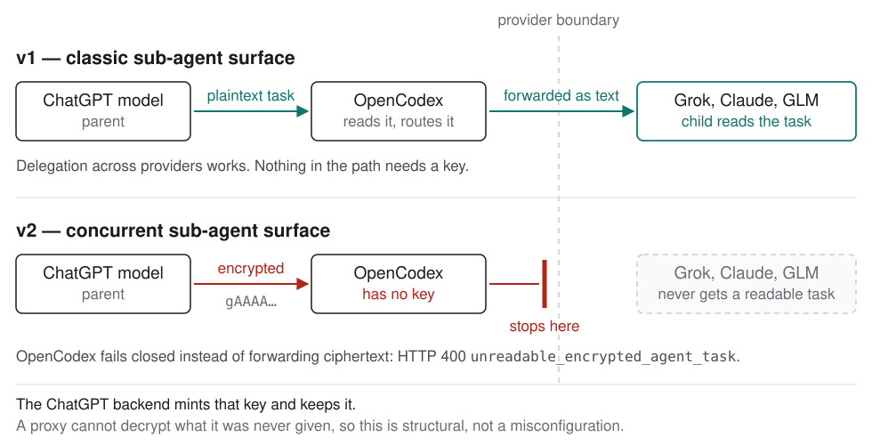

OpenCodex 安装后的子代理界面默认为 **v1**。Dashboard、Models 和 Subagents 页面在切换到 **base** 或 **v2** 前都会要求确认，并链接到本页。CLI 不会提示。

原因明确而具体：在未改变的加密 v2 路径上，从 ChatGPT 原生模型分派给路由模型的任务无法被路由模型读取。这是常见的委派方式——GPT 父代理启动 Grok、Claude 或 GLM 子代理——无法读取的加密任务会在此边界失败。下面的实验性选项改变新任务消息的生成方式，不会解密已有消息。

## 可选的明文任务 V2

**V2 · 明文任务**（`v2-plaintext`）为新会话固定 V2 目录项，同时关闭全局 V2 强制。它保留 V2 的任务名称、层级、后续消息、取消和并发功能，并对符合条件的规范 ChatGPT Responses 请求使用实验性明文编译器。已有会话保留其记录的选择；更新不会自动选择此模式。

目录固定值适用于新会话，编译器则遵循当前设置，处理已有 V2 会话后续符合条件的请求。显式设置独立的 `plaintextV2AgentMessages: true` 也会启用编译器。

明文编译启用时，本地响应 ID 续接要求同一个获准的 opencodex API 密钥身份以及请求自身的 `thread-id`；父线程 ID 不能授权访问子任务。缺少任一身份、代理重启后或使用较旧的未绑定缓存时，请省略 `previous_response_id` 并重新发送完整对话。启用期间保留的状态在切换模式后仍保持绑定；默认 `v1` 对未绑定状态保留按父线程范围续接的行为，包括 loopback 调用方。

仪表板要求确认任务文本可能保留在 Codex 历史、所选提供商请求、本地响应与调试状态中，包括磁盘上的续接快照或 spill 文件。HTTPS 和身份验证仍启用，不会增加恢复模型调用。已有密文不会被解密，已保存的历史不会被改写；禁用编译器也不会删除已保留的副本。不受支持的后端或客户端行为仍可能失败。普通 v1 和原生 v1 / 路由 v2 混合模式仍可使用。

```bash
ocx v2 mode v2-plaintext --live --acknowledge-plaintext-agent-messages
```

使用 `ocx v2 status --live --json` 查看实时目标。配置本地目标时，两个命令都省略 `--live`，并使用 `ocx v2 status --json` 查看；配置状态和目录收敛并不等于真实委派成功。要退出该模式，请明确选择其他模式；独立设置的 `plaintextV2AgentMessages` 值会被保留。

## 发生时会看到什么

启动子代理的请求会被拒绝，而不是静默生成空任务：

```json
{
  "error": {
    "code": "unreadable_encrypted_agent_task",
    "message": "Routed V2 worker task is encrypted for the native ChatGPT backend and cannot be read by the selected provider. Use plaintext V2 agent-message delivery or select a native ChatGPT model."
  }
}
```

响应为 HTTP 400，密文绝不会回传。有意采用封闭式失败：转发无法读取的载荷会让子代理收到空指令，却给出看似确定的错误答案。

## 原因



在 v1 上，父代理以纯文本发出子代理的任务。OpenCodex 读取并路由它，子代理因而收到可执行的内容。

在加密 v2 路径上，父代理以 ChatGPT 后端生成的 `encrypted_content` 发出任务。密钥留在该后端，OpenCodex 从未持有它，因此代理既无法解密也无法改写；该值确实是密文，并不是由标志隐藏的明文。明文编译器只能影响符合条件的新消息，不能修复已有密文。

代理设置无法启用本地解密。实验性 `agentTaskRecovery` 可以请求 ChatGPT 后端恢复符合条件的任务，但不会在本地解密其密文。上述授权、适用条件和失败处理限制仍然有效。

下表比较未启用明文编译器时的拓扑，也有助于理解失败发生的位置：

| 拓扑 | v1 | v2 |
| --- | --- | --- |
| ChatGPT 父代理到路由子代理 | 可用 | **失败** |
| 路由父代理到路由子代理 | 可用 | 可用 |
| ChatGPT 父代理到 ChatGPT 子代理 | 可用 | 可用——后端能解密自己生成的密文 |

后端始终可以读取自己的密文。只有跨越提供商边界时才会失败。

## 上游修复了吗？

还没有，至少关键的发送端没有修复。上游合并了 [openai/codex#35845](https://github.com/openai/codex/pull/35845)，新增了接收明文协作消息的支持，但这只处理*接收*端：它可以处理已经生成的明文，却不会让 OpenAI 父代理生成明文。

发送端的问题仍未解决：[ #36376](https://github.com/openai/codex/issues/36376) 在 Windows、macOS 和 Linux 上的 CLI 0.146 至 0.151 中复现；[#37197](https://github.com/openai/codex/issues/37197) 则直接指出缺少发送端的传递策略。维护者尚未承诺修复或给出时间表。

OpenCodex 在 [#92](https://github.com/lidge-jun/opencodex/issues/92) 记录了影响，并以“不计划处理”关闭：此仓库无法修复，因此该 issue 是上游工作的索引，并非等待这里的维护者处理的任务。

## 模式目前的作用

| 模式 | 界面 | 适用情况 |
| --- | --- | --- |
| **v1**（默认） | 每个模型都提供经典的带命名空间的启动工具。启动时可直接指定另一模型。 | 跨提供商委派的用户。这是当前发布的默认值。 |
| **base** | 上游模型固定设置：Sol 和 Terra 使用 v2，Luna 使用 v1，未固定的模型遵循 Codex 自身的标志。 | 希望采用 Codex 预期的各模型界面，且只在同一提供商内委派。 |
| **v2** | 每个模型都提供扁平的并发工具。 | 希望使用较新的并发会话模型，且父代理与子代理位于边界同侧。 |
| **v2-plaintext** | 新会话使用 V2 目录固定值，全局强制关闭；符合条件的规范 ChatGPT 请求使用明文任务。 | 明确接受任务文本可能被保留、希望使用 V2 委派的用户。 |

base 排在第二而非第一，是因为它将大多数人用于*发起*委派的 Sol 和 Terra 固定在 v2。对于这一问题，base 不是折中选项；ChatGPT 向路由模型启动子代理时，它的行为与 v2 相同。

## 如果已经选择 base 或 v2

现有设置不会被改动。升级到采用这一默认值的版本不会重写既有设置；仪表盘会显示一次通知，等待你的选择。

- **Continue** 保留当前模式，并停止提醒。
- **Switch to v1** 应用 v1，并停止提醒。

两种选择都会被记录，通知不再出现。如果直接关闭通知而未作选择，下次打开仪表盘时仍会看到它。

目录固定值变更对**新建** Codex 会话生效；明文编译器的当前设置也会影响已有 V2 会话后续符合条件的请求。要使用新的目录固定值，请新建会话；如果长期运行的 App 宿主仍显示旧界面，请执行 `ocx sync` 并重启该界面。

## 如果仍想使用 v2

以下四种方法按建议尝试的顺序列出：

1. **让 ChatGPT 保持 v1。** 在 v2 模式中，`keepNativeChatGptOnV1` 开关让 Sol 和 Terra 继续使用 v1 界面，从而仍能启动 Grok 或 Claude；路由父代理则使用 v2。这最接近两者兼得。
2. **在同一提供商内委派。** v2 上，路由父代理启动路由子代理使用明文，正常可用。
3. **信任直接使用密钥认证的 Responses 中继。** 明确设置 `allowEncryptedV2AgentTasks: true` 的提供商会收到不透明载荷，而不是 400。只有确定目标能够处理该载荷时才这样做。
4. **启用 `agentTaskRecovery`。** 此功能为实验性，默认关闭。它通过 ChatGPT 后端恢复无法读取的加密 `NEW_TASK`、`MESSAGE`、`FOLLOWUP_TASK` 和 `FINAL_ANSWER` 项，代价是消耗额度、增加延迟并依赖未文档化的行为；combo 恢复仍仅限于已启动子代理的轮次，而拆分令牌片段仍不受支持。

完整机制见[子代理界面](/zh-cn/guides/sub-agent-surface/)，具体设置见[代理配置](/zh-cn/reference/configuration/agents/)。

## 何时不再需要本页

当上游版本使 ChatGPT 原生父代理以明文发出路由子代理的任务时，默认采用 v1 的原因也会消失。届时默认值会恢复为 base，确认提示不再出现，本页会从建议变成历史记录。

## 更改模式

Dashboard、Models 和 Subagents 提供模式开关；切换到 base、v2 或 v2-plaintext 时需要确认。CLI 的明文模式需要上文所示的确认标志。其他 CLI 命令如下：

```bash
ocx v2 status
ocx v2 mode v1
```

CLI 不会提示。这是同一设置，因此请了解本页描述的行为后再选择。

## 子代理并发上限

在 **Models → Model settings** 中，子代理上限控件可设置同时运行的子代理数量上限，不包括主代理。v1、base 和 v2 均可使用，包括全局 v2 标志关闭的混合模式。界面模式与此上限分别设置。

提高上限可允许更多子代理，但不会自动创建子代理，也不保证执行更快。更改后请启动新的 Codex 会话。如果长时间运行的 App 主机仍使用旧上限，请重新启动该主机。
