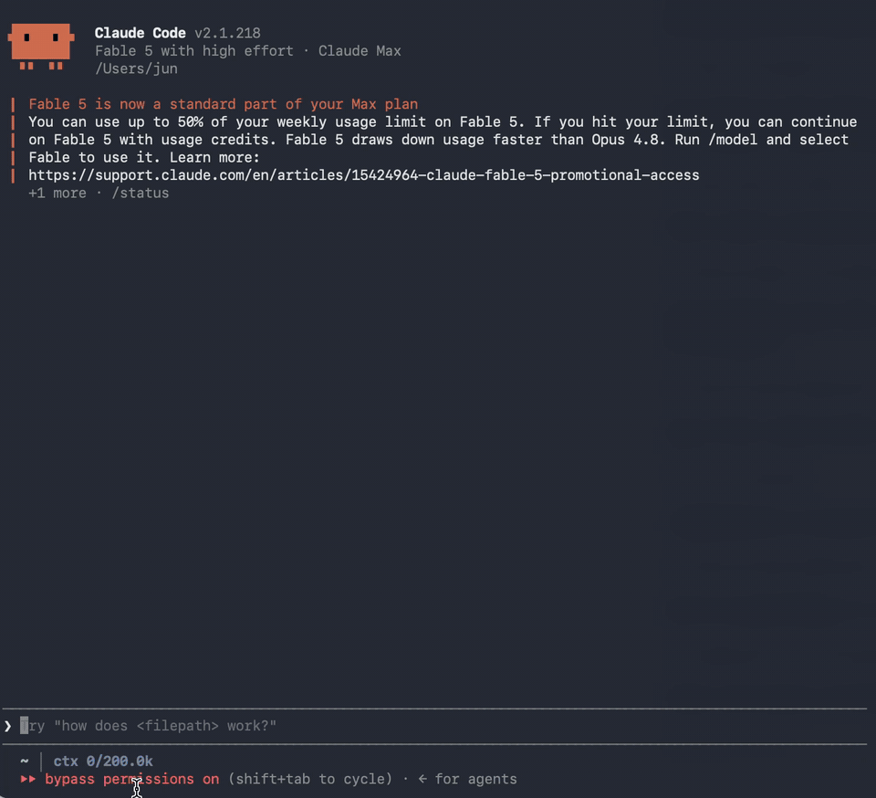
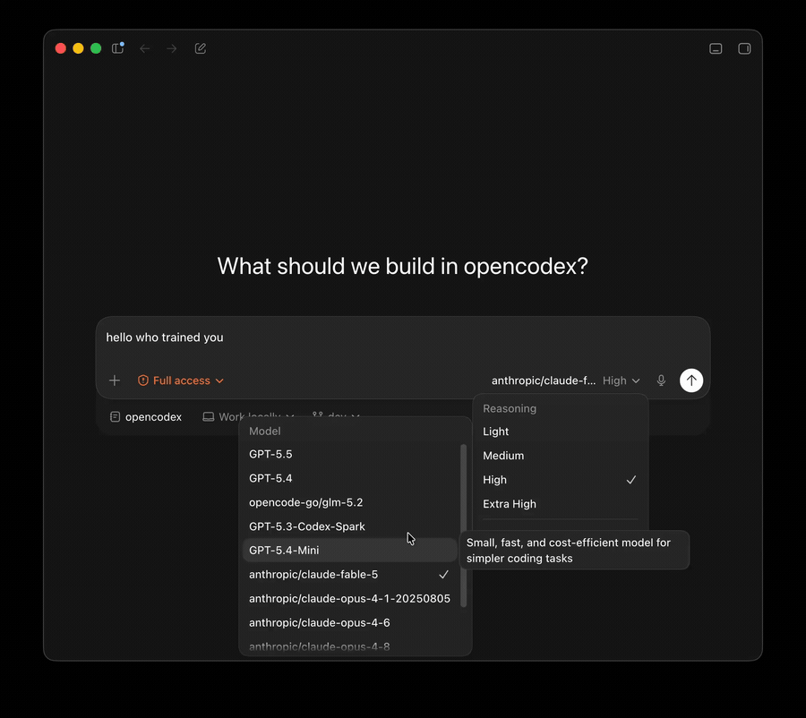
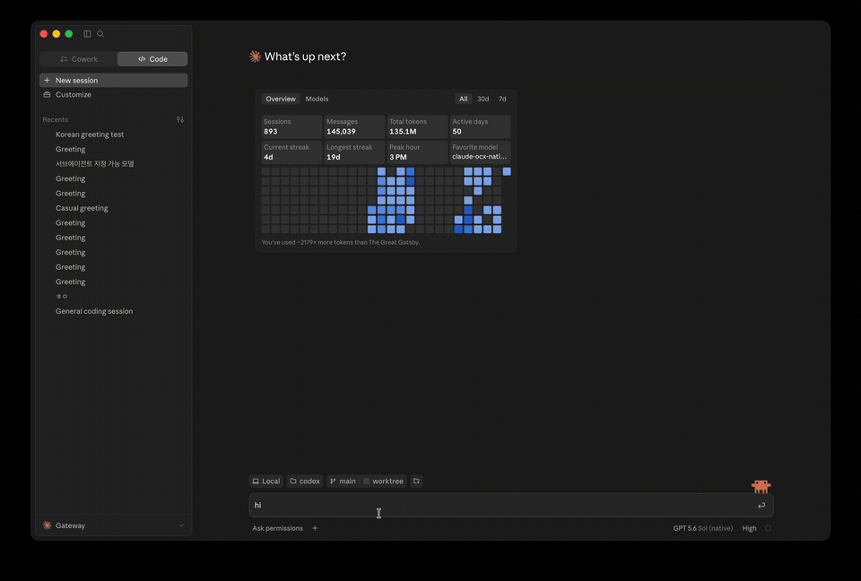
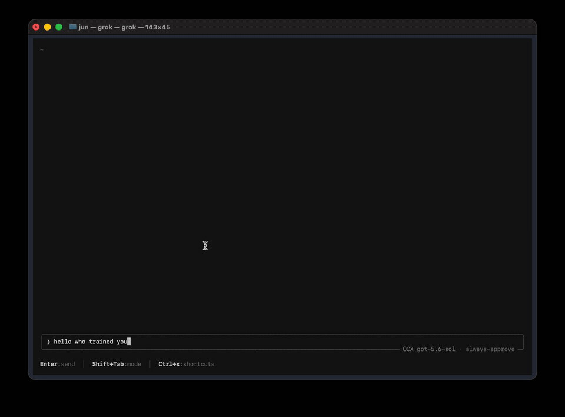

<p align="center">
  
</p>

<h3 align="center">Una puerta de enlace local para tus herramientas de programación con IA y sus modelos.</h3>
<p align="center"><b>Usa los modelos que elijas con Codex, Claude Code, Claude Desktop y Grok Build.<br>
Conecta OpenCode, Pi, Qoder, WorkBuddy, Kilo, Cline, T3 Code y más con configuraciones administradas.</b><br>
<a href="https://opencodex.me/es/reference/client-support/">Ver todas las herramientas compatibles →</a></p>
<p align="center">Parte de GOAT: usa tus agentes de programación con cualquier modelo en cualquier equipo → <a href="https://trygoat.ai">trygoat.ai</a></p>

<p align="center">
  <a href="https://x.com/claudeebum"></a>
  <a href="https://www.npmjs.com/package/@bitkyc08/opencodex"></a>
  <a href="https://github.com/lidge-jun/opencodex/blob/dev/LICENSE"></a>
  
</p>

```bash
npm install -g --allow-scripts=bun @bitkyc08/opencodex
ocx start
```

<p align="center">
  <a href="https://github.com/lidge-jun/opencodex/releases/latest"></a>
  <a href="https://github.com/lidge-jun/opencodex/releases/latest"></a>
  <a href="https://github.com/lidge-jun/opencodex/releases/latest"></a>
  <a href="https://github.com/lidge-jun/opencodex/releases/latest"></a>
</p>

<table>
<tr>
<td width="50%" valign="middle">

### Claude Code, ejecutando cualquier modelo

El selector es el original de Claude Code. El modelo que lo ejecuta puede ser otro.

</td>
<td width="50%">
  
</td>
</tr>
<tr>
<td width="50%" valign="middle">

### Codex, ejecutando cualquier modelo

Elige un proveedor y empieza: el mismo flujo de trabajo, con otro modelo.

</td>
<td width="50%">
  
</td>
</tr>
<tr>
<td width="50%" valign="middle">

### Claude Desktop, ejecutando cualquier modelo

Opus responde, luego entrega la tarea a un subagente GPT-5.6 Sol.

</td>
<td width="50%">
  
</td>
</tr>
<tr>
<td width="50%" valign="middle">

### Grok Build, ejecutando cualquier modelo

Sol dirige la sesión y llama a un subagente Kimi K3.

</td>
<td width="50%">
  
</td>
</tr>
</table>

<p align="center">
  <a href="../README.md">English</a> · <a href="README.fr.md">Français</a> · <a href="README.ko.md">한국어</a> · <a href="README.zh-CN.md">简体中文</a> · <a href="README.zh-TW.md">繁體中文</a> · <a href="README.ru.md">Русский</a> · <a href="README.ja.md">日本語</a> · <a href="README.tr.md">Türkçe</a> · <b>Español</b> · 📖 <a href="https://opencodex.me/es/"><b>Documentación completa →</b></a>
</p>

opencodex es una puerta de enlace local ligera entre tus herramientas de programación y los proveedores de modelos.
Recibe solicitudes de las API Responses, Chat Completions y Anthropic Messages, y las adapta al protocolo del proveedor.
Admite respuestas en streaming, llamadas a herramientas, razonamiento e imágenes cuando el cliente, el modelo y el proveedor
son compatibles. Usa Claude, Gemini, Grok, GLM, DeepSeek, Kimi, Qwen, Ollama y otros proveedores con Codex, Claude Code,
Claude Desktop, Grok Build y las herramientas de la [página de clientes compatibles](https://opencodex.me/es/reference/client-support/).

## Inicio rápido

### Instalación personal (CLI)

```bash
npm install -g --allow-scripts=bun @bitkyc08/opencodex   # Node 18+; incluye Bun automáticamente
ocx start                         # proxy y panel en localhost:10100
```

Usa `ocx service` para ejecutarlo en segundo plano.

Abre **http://localhost:10100** y configúralo desde el dashboard web: añade proveedores (más de 40 integrados o cualquier endpoint compatible con OpenAI), elige modelos y administra cuentas. `ocx gui` vuelve a abrir el dashboard cuando lo necesites.

### Conecta tu herramienta

Conecta la herramienta que ya utilizas:

| Herramienta | Cómo conectarla |
|---|---|
| Codex | Activa Codex en **Enrutamiento** en el panel y ejecuta `codex` como de costumbre. Si el proxy escucha localmente, esto dirige el proveedor integrado de Codex al proxy. Desde una terminal, ejecuta `ocx init` antes de añadir proveedores en el panel y acepta la opción de Codex. |
| Claude Code | Una vez instalada la CLI `claude`, ejecuta `ocx claude`. Inicia el proxy si hace falta y abre Claude Code a través de él. |
| Claude Desktop | Ejecuta `ocx claude desktop`. Para una instalación nueva configura el perfil de puerta de enlace para toda la aplicación. Conserva una configuración oficial existente; `ocx claude desktop apply --gateway` cambia explícitamente al perfil de puerta de enlace. Consulta la [guía de Claude Code](https://opencodex.me/es/guides/claude-code/). Cierra por completo y vuelve a abrir Claude Desktop después de cambiar. |
| Grok Build | Si el proxy escucha localmente, la integración de Grok está habilitada y existe `~/.grok`, `ocx start` registra los modelos. Elige un modelo `ocx-*` en Grok Build. Para el acceso remoto, consulta la [guía de Grok Build](https://opencodex.me/es/guides/grok-build/). Después de añadir proveedores, reinicia el proxy (o ejecuta `ocx ensure` si está habilitado el inicio automático con Codex) para actualizar la lista. |
| Herramientas con integración administrada | Usa **Enrutamiento** en el panel o `ocx integration client enable --client <id>`. |
| Cualquier otra herramienta | Configura `http://localhost:10100/v1` como URL base compatible con OpenAI o `http://localhost:10100` como URL base para Anthropic. |

La [página de clientes compatibles](https://opencodex.me/es/reference/client-support/) indica cómo conectar cada herramienta y qué protocolo usa.

<details>
<summary><b>Aplicación de escritorio (beta)</b></summary>

La aplicación de escritorio integra el mismo proxy y dashboard en una ventana nativa, con una bandeja y su propio `ocx`. Se conecta a un proxy existente o inicia el que incluye, y el dashboard sigue usando el puerto del proxy (**http://localhost:10100**, salvo que configures otro). Elige el archivo de tu plataforma en la [última versión](https://github.com/lidge-jun/opencodex/releases/latest):

| Plataforma | Archivo | Notas |
|---|---|---|
| macOS 13+ (Apple Silicon e Intel) | `OpenCodex-<version>-macos.dmg` | Compilación universal, con firma de Developer ID y certificación de Apple |
| Windows (x64) | `OpenCodex-<version>-windows-x64.msi` | Se está incorporando la firma de código mediante SignPath Foundation ([política de firma](https://opencodex.me/es/reference/code-signing/)); hasta que la versión tenga firma, SmartScreen muestra un aviso: elige **Más información → Ejecutar de todas formas** |
| Linux (x86_64) | `OpenCodex-<version>-linux-x86_64.AppImage` o `-linux-amd64.deb` | La bandeja necesita un escritorio compatible con AppIndicator |

Cada archivo tiene su `.sha256` en la página de versiones. En macOS 14 o posterior, la aplicación incluye una extensión WidgetKit que muestra el estado del proxy, el uso de hoy y las cuotas de proveedores. Su modelo de instantáneas está en [`app/`](../app), en `MenuBarCore`. Para compilar la aplicación, ejecuta
`bun install && bun run build:gui` en la raíz del repositorio. Después, desde `desktop/`, ejecuta
`bun install && bun run prepare-sidecar && bun run prepare-widget && bun run build:local` en macOS, o `bun install && bun run prepare-sidecar && bun run build:local` en Windows y Linux (el paso del widget requiere macOS). La [guía de Desktop](https://opencodex.me/es/guides/desktop-app/) y la
[guía de barra de menús de macOS](https://opencodex.me/es/guides/macos-menu-bar/) explican el primer inicio, y
[`AGENTS_INSTALL.md`](../AGENTS_INSTALL.md#where-things-are-installed) enumera todo lo que se escribe en el disco.

</details>

### Patrocinadores

Los patrocinadores permiten mantener opencodex al día con los cambios de protocolo de los proveedores. ¿Te interesa? Consulta [SPONSORS.md](../SPONSORS.md).

<!-- sponsors:main — one banner, model developers only; empty until a Main sponsor signs -->

<!-- sponsors:standard — one row per sponsor, in order of signing -->
<table>
<tbody>
<tr>
<td width="180"><a href="https://www.orcarouter.ai/?utm_source=opencodex&utm_medium=readme"></a></td>
<td>Gracias a <a href="https://www.orcarouter.ai/?utm_source=opencodex&utm_medium=readme">OrcaRouter</a> por patrocinar este proyecto. OrcaRouter es una pasarela de IA compatible con OpenAI para producción: evalúa cada instrucción y la dirige al modelo que satisface tus requisitos, con conmutación automática ante fallos, reglas de enrutamiento como código, precios del proveedor sin recargos y caché de instrucciones. Incluye controles de protección, un firewall para agentes y registros de cada solicitud en más de 200 modelos. Selecciona <code>OrcaRouter</code> en Añadir proveedor o ejecuta <code>ocx provider add orcarouter</code>; <code>orcarouter/auto</code> es el enrutador adaptativo.</td>
</tr>
<tr>
<td width="180"><a href="https://tokenlab.sh/r/OPENCODEX"><picture><source media="(prefers-color-scheme: dark)" srcset="../assets/sponsors/tokenlab-dark.png"></picture></a></td>
<td>Gracias a <a href="https://tokenlab.sh/r/OPENCODEX">TokenLab</a> por patrocinar este proyecto. TokenLab ofrece a los agentes de programación una clave API para los principales modelos. Admite OpenAI Responses y Chat Completions, Anthropic Messages y los formatos nativos de Gemini, con streaming y llamadas a herramientas. También proporciona un servidor MCP y skills para facilitar la integración. Puedes elegir el modo de entrega y pagar según el uso. Selecciona <code>TokenLab</code> en Añadir proveedor o ejecuta <code>ocx provider add tokenlab</code>.<br><sub>TokenLab unifica el acceso a varios modelos con una clave API, admite los protocolos y herramientas indicados y permite integrar el servidor MCP y las skills en los flujos de trabajo existentes, con modos de entrega opcionales y pago por uso.</sub></td>
</tr>
</tbody>
</table>

---

<details>
<summary>Docker Compose</summary>

El repositorio incluye una compilación de Compose que se ejecuta sin root y fija las imágenes por digest. La compilación genera y verifica el manifiesto canónico de compatibilidad a partir de la instantánea de Git elegida. Un clon local necesita Git y Docker Compose; un contexto remoto de Git necesita Docker Compose. Ninguna opción requiere Bun instalado en el anfitrión ni un paso previo de preparación. Inicializa una vez el token del plano de datos mediante stdin e inicia el Hub:

```bash
git clone https://github.com/lidge-jun/opencodex.git
cd opencodex
docker compose build
openssl rand -hex 32 | docker compose run --rm -T hub bun run docker/bootstrap-token.ts
docker compose up -d
curl --fail --silent http://127.0.0.1:10100/healthz
curl --fail --silent http://127.0.0.1:10100/readyz
```

La dirección predeterminada es `127.0.0.1:10100`. Para exponerla de forma remota debes indicar
`OPENCODEX_BIND_ADDRESS=<LAN-or-Tailscale-IP> docker compose up -d`; `0.0.0.0` habilita todas las interfaces del anfitrión. Restringe el acceso con un firewall y un punto de entrada TLS o tailnet autenticado. El JSON generado no se añade al control de versiones. El contexto de compilación solo admite `.git/index` y `.git/HEAD`, el inventario que lee `git ls-files`: aproximadamente 1 MB en lugar de todo el almacén de objetos. Solo la etapa que genera el manifiesto los ve mediante un montaje de solo lectura, por lo que ningún `COPY` incluye `.git`. Un manifiesto generado previamente en el anfitrión solo se acepta después de validarlo; en caso contrario, la compilación genera uno. Se rechazan manifiestos desactualizados, archivos ausentes o distintos, archivos de origen adicionales y enlaces simbólicos. Se comprueba cada SHA-256 registrado frente al contexto de compilación y los archivos copiados al entorno de ejecución, incluidos
`package.json`, `bun.lock` y el archivo expresamente incluido `scripts/model-metadata.source.json`.

Un contexto remoto de Git necesita que BuildKit conserve los metadatos de Git. Este fragmento de Compose elige la instantánea remota y transmite el argumento integrado necesario:

```yaml
services:
  hub:
    pull_policy: build
    build:
      context: https://github.com/lidge-jun/opencodex.git#dev
      dockerfile: Dockerfile
      target: runtime
      args:
        BUILDKIT_CONTEXT_KEEP_GIT_DIR: "1"
```

El token y el estado mutable permanecen en el volumen con nombre `ocx-state`. No se incluyen credenciales en la imagen, el archivo de Compose, las variables de entorno ni los argumentos de shell. Consulta la
[guía de despliegue de Remote Hub](https://opencodex.me/es/guides/remote-hub/#docker-compose) para configurar proveedores, realizar comprobaciones autenticadas, administrar el sistema de forma remota y revertir cambios.

</details>

<details>
<summary>Instalar desde el código fuente, con dev actualizado</summary>

**macOS / Linux:**

```bash
curl -fsSL https://bun.sh/install | bash
git clone -b dev https://github.com/lidge-jun/opencodex.git
cd opencodex && ~/.bun/bin/bun install
~/.bun/bin/bun run build:gui
~/.bun/bin/bun run src/cli/index.ts start
```

**Windows (PowerShell):**

```powershell
irm bun.sh/install.ps1 | iex
git clone -b dev https://github.com/lidge-jun/opencodex.git
cd opencodex; bun install
bun run build:gui
bun run src/cli/index.ts start
```

La instalación desde el código fuente ejecuta la rama `dev` actual. Los parches de gestión de memoria, las mejoras del recolector de basura y las correcciones pendientes de publicación están disponibles aquí antes de llegar al paquete npm.

</details>

<details>
<summary>Para los agentes</summary>

```bash
npm install -g --allow-scripts=bun @bitkyc08/opencodex
ocx start     # or `ocx service`
ocx init      # interactive setup: writes ~/.opencodex/config.json and wires Codex
```

`ocx init` nunca inicia el proxy; puedes iniciarlo antes o después de configurar. `ocx provider add` escribe la configuración local y no requiere un proxy en ejecución. Los comandos de administración en vivo, como `ocx combo set`, se comunican con el proxy **en ejecución** y terminan con un código distinto de cero si no está accesible. `ocx status`, `ocx doctor` y `ocx health` informan del estado de ejecución.

> **Agentes que instalan o ejecutan opencodex:** lean
> [`AGENTS_INSTALL.md`](../AGENTS_INSTALL.md). Una ejecución interactiva de `ocx start` puede preguntar una vez si se desea
> dar una estrella al repositorio: esa decisión corresponde al usuario. La CLI oculta la pregunta
> en ejecuciones de agentes y la API rechaza esas acciones con `403 agent_consent_required`.

</details>

## Plataformas compatibles

| Sistema operativo | Estado | Gestor de servicios | Aplicación de escritorio (beta) |
|---|---|---|---|
| macOS (arm64 / x64) | Compatibilidad completa | launchd | Universal `.dmg` |
| Linux (x64 / arm64) | Compatibilidad completa | systemd (unidad de usuario) | x86_64 `.AppImage` / `.deb` |
| Windows (x64) | Compatibilidad completa | Programador de tareas (oculto) o servicio nativo opcional (`--native`, WinSW) | x64 `.msi` |

La instalación de la CLI requiere [Node](https://nodejs.org) 18 o posterior; Desktop no necesita Node ni Bun. `npm install` incluye el entorno de ejecución Bun: no requiere instalar Bun por separado ni usar WSL en Windows. Si npm bloqueó los scripts de instalación de ese entorno, consulta la [guía de instalación](https://opencodex.me/es/getting-started/installation/).

## Puntos destacados

- **Usa cualquier LLM con Codex, Claude Code, Claude Desktop y Grok Build**: más de 40 proveedores integrados, manteniendo la interfaz nativa de cada cliente.
- **Combos**: un identificador de modelo virtual con conmutación por error o round-robin ponderado entre proveedores. Consulta la [guía de Combos](https://opencodex.me/es/guides/combos/).
- **Subagentes con cualquier modelo**: incluye modelos enrutados en el selector de subagentes de Codex, con controles de interfaz v1/v2 y cadenas de respaldo. Consulta la
  [guía de subagentes](https://opencodex.me/es/guides/sub-agent-surface/).
<!-- sponsors:main-first-mention -->
- **Inicia sesión sin una clave API**: OAuth para xAI, Anthropic y Kimi; también puedes reenviar
  `codex login`, pegar una clave o usar referencias `${ENV_VAR}`.
- **Sidecars de búsqueda web y visión**: los modelos de otros proveedores obtienen búsqueda web y comprensión de imágenes mediante un sidecar con tu sesión de ChatGPT.
- **Consulta lo que ocurre**: el dashboard muestra proveedores, estado de OAuth, selección de modelos y un registro de solicitudes en tiempo real con el conteo de tokens de caché.
- **Salida limpia, sin residuos**: `ocx stop` restaura la configuración original de Codex.
- **Memoria acotada**: cada caché persistente, búfer circular y almacén de conversión de protocolos tiene un límite finito, presupuesto de bytes o reconciliación activa. Ningún `Map` o `Set` sin límite
  sobrevive a una recarga de configuración.

<details>
<summary>Detalles de gestión de memoria</summary>

OpenCodex controla el estado que retiene el proceso en estas categorías, cada una con un límite documentado:

- **14 almacenes retenidos** (registro de solicitudes, búferes de depuración, cachés de imágenes y modelos, descripciones de visión, blobs de Cursor, continuación de Responses, etc.) contabilizan bytes y liberan entradas según el presupuesto de memoria de la aplicación (256 MiB de forma predeterminada). El almacén de reproducción del control nativo permanece fijado y no libera sus entradas.
- **4 búferes observados** (acumuladores del conversor y colas finales de imágenes, OAuth y Grok) se supervisan para medir la presión de bytes en curso, sin liberar entradas.
- **32 registros de almacenes de estado** realizan barridos de vencimiento cada 60 segundos y reconcilian la generación de configuración para eliminar claves antiguas de proveedores y cuentas.
- **Cachés de rutas y huellas** (metadatos de espacios de trabajo, identidades reforzadas, sales de instalación y capacidades de indicadores de modo) usan límites LRU por orden de inserción de 8 a 128 entradas.
- **Marcas de eliminación de generaciones de la caché de modelos** se borran después de reconciliar. Incrementar la generación global impide que descubrimientos antiguos todavía en curso vuelvan a añadir proveedores eliminados.
- **Deduplicación de identificadores de eventos del Lab** se ejecuta desde el disco bajo un bloqueo del registro, sin un índice en la RAM del proceso.

Consulta `GET /api/system/memory` con el token de administrador para inspeccionar los bytes retenidos, los contadores de liberación de entradas y las muestras de supervisión.

</details>

## Enrutamiento de modelos

Selecciona cualquier proveedor y modelo configurado con la sintaxis `provider/model`:

```bash
codex -m "anthropic/claude-opus-5" "Explain this stack trace"
codex -m "google/gemini-3-pro" "Write unit tests for auth.ts"
codex -m "ollama/llama3" "Refactor this function"
```

Omite el prefijo `provider/` para usar el proveedor predeterminado o la coincidencia automática por patrón de nombre. Los identificadores que contienen `/` se muestran con las barras internas sustituidas por `-`; la forma original con todas las barras también funciona. Consulta la [guía de enrutamiento de modelos](https://opencodex.me/es/guides/model-routing/).

### Enrutamiento automático con JEV, opcional

TypeSafe JEV puede elegir el primer modelo y el esfuerzo de razonamiento de un Combo habilitado expresamente. El selector normal y las rutas directas conservan su comportamiento. Añade la credencial con `ocx login jev`, desde
**Proveedores → TypeSafe JEV → Añadir clave API** o mediante `TYPESAFE_API_KEY`/`JEV_API_KEY`. Después abre
**Modelos → Combos → Crear JEV Auto**, elige los modelos de destino permitidos y comprueba qué esfuerzos de razonamiento puede seleccionar JEV para cada uno. Si no restringes el esfuerzo de un destino, se permiten todos los niveles que anuncie ese modelo.

JEV se consulta solo para `jev-auto` y una sola vez por llamada lógica al modelo. Si faltan credenciales, falla la red o la decisión no es válida, se usa como alternativa el primer destino disponible. La cancelación del solicitante sigue cancelando la solicitud. Las pruebas automatizadas usan un endpoint simulado de TypeSafe y no validan una cuenta JEV real.

Un Combo JEV puede consultar un modelo de decisión autoalojado, como `tev1` de Ollama sin clave: añade un proveedor
`jev-decision` cuyo `baseUrl` sea el endpoint completo `/v1/systemone` y establece
`decisionProvider` del Combo en el identificador de ese proveedor. Las credenciales de TypeSafe nunca se envían allí. Consulta:
[Servidor compatible con System One](https://opencodex.me/es/guides/combos/#system-one-compatible-server).

## Proveedores y adaptadores

<!-- sponsors:main-first-mention -->
OpenAI (sesión de ChatGPT o clave API), Anthropic, Google Gemini, xAI, Kimi, Azure OpenAI, Ollama
(local y nube), Cursor (experimental) y cualquier endpoint compatible con OpenAI. También DeepSeek, Groq, OpenRouter, OpenGateway, Together, Fireworks, Cerebras, Mistral, Hugging Face, NVIDIA NIM, MiniMax,
Qwen Cloud, Qoder Global y CN (PAT oficial y CLI), SiliconFlow y más. Consulta la lista completa en `ocx init` o en la
[guía de proveedores](https://opencodex.me/es/guides/providers/).

## CLI

```bash
ocx init                       # interactive setup (writes config, wires Codex, offers the shim)
ocx start [--port 10100] [--socks5 [host:port] | --socks5-off]  # SOCKS5 defaults to socks5://127.0.0.1:10808
ocx stop                       # stop + restore native Codex
ocx service [install|repair|restart|start|stop|status|uninstall|remove]  # background service
ocx codex-shim install         # start the proxy on demand whenever `codex` launches
ocx health [--json]            # check immediate proxy liveness
ocx ready [--json] [--wait [--timeout <seconds>]]  # check post-sync readiness
ocx status                     # is the proxy running?
ocx gui                        # open the web dashboard
ocx provider <...>             # manage providers (list/add/edit/test/remove)
ocx account <...>              # manage ChatGPT accounts & API-key pools
ocx combo <...>                # manage failover / round-robin combos
ocx v2 <...>                   # multi-agent v1/v2 surface controls
ocx update [--tag preview]     # update opencodex
```

Si el puerto preferido está ocupado, el inicio se detiene e identifica qué lo ocupa, en lugar de cambiar de puerto y dejar otro proxy ejecutándose. Libera el puerto o elige otro con `--port`. Consulta la [referencia de CLI](https://opencodex.me/es/reference/cli/).

### Salud y preparación

`GET /healthz` comprueba si el proxy responde en ese momento. El endpoint sin autenticación `GET /readyz` informa de su disponibilidad después de la sincronización, con la identidad JSON depurada `{service, version, uptime, pid, port, status}`. Devuelve `200` cuando `status` es `ready`; los estados `pending` y `failed` devuelven `503` con
`Retry-After: 1`.

`ocx ready [--json] [--wait [--timeout <seconds>]]` realiza una sola comprobación de forma predeterminada. `--wait` consulta durante un máximo predeterminado de 45 segundos, pero termina en cuanto detecta el estado terminal `failed`.
`--timeout <seconds>` fija un límite de 1 a 300 segundos, requiere `--wait` y solo acepta enteros positivos. Con `--json`, la salida es
`{ready, status, pid, port}`, donde `status` puede ser `ready`, `pending`, `failed` o `unreachable`.

| Código de salida | Resultado |
| --- | --- |
| `0` | Listo |
| `1` | No listo: pendiente, fallido, tiempo de espera o inalcanzable |
| `64` | Argumentos no válidos |

Un proxy antiguo sin `/readyz` se considera `unreachable` y produce el código de salida 1. `ocx health`
sigue siendo compatible con él.

### Inicio automático: servicio y shim

Usa el **servicio** (`ocx service`) para mantener el proxy activo y reiniciarlo si falla. Usa el
**shim** (`ocx codex-shim install`) para iniciarlo bajo demanda, sin un proceso permanente en segundo plano. Puedes quitarlos con `ocx service uninstall` y `ocx codex-shim uninstall`.

### Desinstalar

```bash
ocx uninstall                  # stop, remove service/shim, restore native Codex, clean up state
npm uninstall -g @bitkyc08/opencodex
```

## Acceso remoto

De forma predeterminada, opencodex escucha en `127.0.0.1` y no necesita autenticación adicional del plano de datos.
Escuchar fuera de loopback (`"hostname": "0.0.0.0"`) **requiere una credencial de datos**.
El token puede proceder de `OPENCODEX_API_AUTH_TOKEN`, de `OCX_API_TOKEN_FILE` o del archivo privado
`service-api-token`, accesible solo para su propietario, que puede crear `ocx service install`.
Las claves API de cliente configuradas también permiten la admisión de datos. Los clientes envían una
credencial aceptada en `x-opencodex-api-key`. La administración utiliza una credencial independiente:
`OPENCODEX_ADMIN_AUTH_TOKEN` o el token administrativo generado. Un token de datos no concede acceso
administrativo. Detalles: [referencia de configuración](https://opencodex.me/es/reference/configuration/).

## Uso avanzado

Opciones autohospedadas para usuarios avanzados. Revisa las condiciones de cada proveedor antes de habilitarlas.

### Grupo de cuentas de ChatGPT

opencodex también administra un **grupo de cuentas de ChatGPT** para autenticar Codex. Añade varias cuentas de ChatGPT/Codex y actualiza sus cuotas de 5 horas, semanales o de 30 días en el dashboard. El enrutamiento por cuota puede asignar las sesiones nuevas a la cuenta disponible con menor uso; round-robin y fill-first aplican sus propias políticas. Los hilos existentes normalmente conservan afinidad con su cuenta inicial, de modo que las sesiones largas de SSH, tmux o móviles no cambien de cuenta a mitad de la conversación. Sin embargo, la reevaluación de cuotas, la conmutación por error, la exclusión de una cuenta, el vencimiento de la afinidad o la recuperación de errores 401/403 y 429 pueden reasignarlos. Define un orden de selección si una cuenta —normalmente la de tu sesión de Codex Desktop— debe usarse solo después de agotar las demás.

- **Agrupa cuentas de ChatGPT**: afinidad por hilo, cambio automático según cuota, periodos de espera y autenticación que rechaza la operación cuando no puede validarla.

  > **Política de los proveedores:** agrupar cuentas sirve para el enrutamiento y la continuidad operativa;
  > no garantiza protección frente a límites de solicitudes, medidas de cumplimiento, suspensiones u otras
  > acciones del proveedor. OpenCodex no respalda el uso de cuentas adicionales para eludir límites ni
  > compartir credenciales entre personas. Te corresponde cumplir las condiciones vigentes de cada
  > proveedor. Consulta la
  > [guía de grupos de cuentas de Codex Auth](https://opencodex.me/es/guides/web-dashboard/#codex-auth-and-account-pools)
  > y los [términos de uso de OpenAI](https://openai.com/policies/terms-of-use/).

## Documentación

La documentación pública de instalación, proveedores, enrutamiento, Combos, subagentes, sidecars, integraciones y referencias de CLI, configuración y API de administración se genera desde [`docs-site/`](../docs-site) y se publica en **[opencodex.me](https://opencodex.me/es/)**.

Los contratos de arquitectura de los mantenedores están en [`structure/`](../structure), las instrucciones para contribuir en
[`CONTRIBUTING.md`](../CONTRIBUTING.md) y la política de seguridad en [`SECURITY.md`](../SECURITY.md). Informa de las vulnerabilidades no divulgadas mediante el
[formulario privado de GitHub](https://github.com/lidge-jun/opencodex/security/advisories/new). Ese formulario es el único canal técnico; no existe un correo de seguridad. El seguimiento se mantiene en el informe privado. Una issue pública solo puede contener coordinación, nunca detalles de la vulnerabilidad. Acusar recibo no equivale a clasificar el informe y no se promete un plazo para la primera respuesta.

## Desarrollo

Desarrollar desde el código fuente requiere la CLI `bun` en el `PATH`. El paquete npm publicado incluye su propio entorno Bun para los comandos `ocx` instalados; los scripts del paquete también pueden resolver Bun mediante esa dependencia incluida.

```bash
git clone https://github.com/lidge-jun/opencodex.git
cd opencodex
bun install
bun run typecheck
bun run test
```

Consulta **[Cómo contribuir](../CONTRIBUTING.md)**.

Las contribuciones integradas mediante un traslado o una reimplementación cuyos commits no reconocen al autor original se registran en
**[CREDITS.md](../CREDITS.md)**.

## Política de firma de código

Los binarios de Windows están incorporando la firma Authenticode ([#7207](https://github.com/lidge-jun/opencodex/issues/7207)). La [guía de firma de código en Windows](https://opencodex.me/es/reference/code-signing/) explica el despliegue, la verificación de firmas y la política completa.

Firma de código gratuita proporcionada por [SignPath.io](https://about.signpath.io/), con certificado de [SignPath Foundation](https://signpath.org/).

- Autores de commits y revisores: [lidge-jun](https://github.com/lidge-jun)
- Aprobadores: [lidge-jun](https://github.com/lidge-jun)
- Privacidad: OpenCodex envía a telemetry.opencodex.me un resumen anónimo diario de uso. Incluye un hash de instalación que cambia cada día, versión, canal de publicación, plataforma, canal de instalación, tipo de proveedor, familia general del modelo, minutos de actividad y recuentos de solicitudes, tokens y errores. Nunca incluye prompts, salidas del modelo, claves, cuentas, nombres de host ni rutas. Solo se envía si quien instala u opera OpenCodex ha visto el aviso en el panel o en la CLI interactiva y no ha rechazado el envío. Puedes desactivarlo desde ese aviso, en el instalador de Windows (opción de estadísticas anónimas de uso, marcada por defecto), en Detalles del proxy, o mediante `ocx telemetry disable`, `OCX_TELEMETRY=0` o `DO_NOT_TRACK=1`. Solo se publican los totales agregados de este proyecto. Hay un perfil de clasificación pública separado, desactivado hasta que lo conectes desde Inicio en el panel o con `ocx telemetry profile connect`. Solo comparte el alias, nombre visible y color que elijas, y tus totales diarios de solicitudes, tokens y familias de modelos. Nunca comparte tu ID de telemetría anónima. Al desconectar el perfil se elimina. Todo lo demás solo se envía a los proveedores y servicios que configures. Consulta la [guía de telemetría](https://opencodex.me/es/guides/telemetry/).

## Aviso legal

opencodex es un proyecto independiente, mantenido por la comunidad y **no está afiliado ni respaldado por OpenAI, Anthropic o cualquier otro proveedor**.

Algunos proveedores, especialmente Anthropic (Claude), pueden suspender o restringir las cuentas que enrutan tráfico de API mediante proxies de terceros. **Úsalo bajo tu responsabilidad (UAYOR).** Antes de conectar un proveedor, revisa sus términos de servicio para confirmar que permiten el acceso mediante proxy. Los mantenedores de opencodex no son responsables de las medidas que los proveedores apliquen a las cuentas.

## Licencia

MIT
